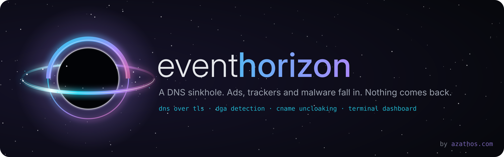
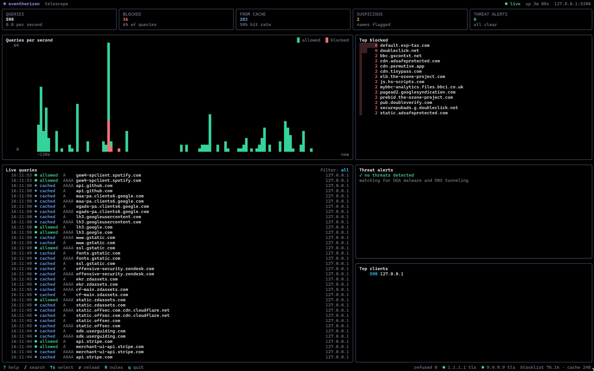

<p align="center">
  
</p>

<p align="center">
  <a href="https://github.com/0xAzathos/eventhorizon/actions/workflows/ci.yml"></a>
  <a href="https://github.com/0xAzathos/eventhorizon/releases"></a>
  <a href="LICENSE"></a>
  <a href="https://azathos.com"></a>
</p>

eventhorizon is a DNS sinkhole that blocks ads and trackers for every app on your machine or your whole network, and watches for malware while it does. It comes with **telescope**, a terminal dashboard where you see every query live and block or allow a domain with one key.



## What it does

* **Blocks ads and trackers** using any hosts style or plain domain list, downloaded by URL or read from a file. Blocking a domain also blocks its subdomains. Blocked names get `0.0.0.0` or `::`, so apps fail fast instead of waiting.
* **Catches CNAME cloaking**, where a tracker hides behind a harmless looking subdomain of the site you visit. If any name in the CNAME chain is blocked, the answer is blocked.
* **Encrypts your lookups** with DNS over TLS to Cloudflare and Quad9 by default, so your ISP cannot read or tamper with them. Connections are reused, and a resolver that fails is skipped for 30 seconds while the next one takes over.
* **Detects malware behaviour.** A model trained on real domain names flags random looking names made by DGA malware, and per client alerts fire when a device produces bursts of failed lookups (DGA) or streams of data shaped subdomains (DNS tunneling). Popular domains are never flagged.
* **Caches answers** with proper TTL handling, including negative answers.
* **Your own rules** win over every list. Add them from telescope or the API; they are saved to a file and survive restarts.
* **Safe on a network.** Only loopback and private addresses may query by default, every client is rate limited, and strangers get no reply, so with the default settings it cannot be used to amplify attacks on others. The service runs sandboxed as a throwaway user.
* **No dependencies.** The server is a single static binary using only the Go standard library.

## Install

Download the archive for your system from the [releases page](https://github.com/0xAzathos/eventhorizon/releases) and unpack it. Each archive holds `eventhorizon`, `telescope`, this README and the license; Linux archives also hold the systemd unit.

Every release file carries signed build provenance, so you can check it was built by this repository's release workflow and not swapped afterwards:

```sh
gh attestation verify eventhorizon_v0.1.0_linux_amd64.tar.gz --repo 0xAzathos/eventhorizon
```

Or build it with Go 1.24 or newer:

```sh
go install github.com/0xAzathos/eventhorizon@latest
```

telescope needs Go 1.26 and is built from a clone, since it uses the server's packages from the same repository:

```sh
git clone https://github.com/0xAzathos/eventhorizon
cd eventhorizon/telescope
go build -o telescope .
```

### Versions

Patch releases (v0.1.1, v0.1.2) hold small changes and fixes and are always safe to upgrade to. Minor releases (v0.2.0) bring bigger features, and before 1.0 they are also the only place breaking changes go, such as renamed flags, new defaults or changed file formats. Those are listed at the top of the release notes.

## Quick start

```sh
eventhorizon -blocklist https://raw.githubusercontent.com/StevenBlack/hosts/master/hosts
```

It listens on `127.0.0.1:5300`. Try it from another terminal:

```sh
dig @127.0.0.1 -p 5300 doubleclick.net     # 0.0.0.0, blocked
dig @127.0.0.1 -p 5300 example.com         # a real answer
```

Then open the dashboard:

```sh
telescope
```

## Use it for your whole machine (Linux with systemd)

1. Install the binary and the service:

   ```sh
   sudo install eventhorizon /usr/local/bin/
   sudo install -m 644 eventhorizon.service /etc/systemd/system/
   sudo systemctl daemon-reload
   sudo systemctl enable --now eventhorizon
   ```

   The service runs as a throwaway unprivileged user in a systemd sandbox and keeps its state (downloaded lists and your rules) in `/var/lib/eventhorizon`. Edit the `ExecStart` line to change flags or lists.

2. Point systemd-resolved at it by creating `/etc/systemd/resolved.conf.d/eventhorizon.conf`:

   ```ini
   [Resolve]
   DNS=127.0.0.1:5300
   Domains=~.
   ```

   ```sh
   sudo systemctl restart systemd-resolved
   resolvectl query doubleclick.net    # should give 0.0.0.0
   ```

`sudo systemctl reload eventhorizon` downloads the lists again without a restart. Lists also refresh every 24 hours, and if a download fails the last good copy is used.

## Use it for your whole network

Run it on an always on machine such as a Raspberry Pi (use the `linux_arm64` or `linux_arm` archive). In the service file:

1. Change `-listen` to that machine's LAN address on port 53, for example `-listen 192.168.1.10:53`.
2. Uncomment `AmbientCapabilities=CAP_NET_BIND_SERVICE`, which allows port 53 without root.
3. Set your router's DHCP DNS server to that address.

Devices pick it up when they renew their lease. Only loopback and private addresses are served unless you change `-allow-clients`. Tailscale addresses are not in the private group; to serve your tailnet, use `-allow-clients loopback,private,100.64.0.0/10`.

Never use `-allow-clients any` on a machine with a public address, such as a VPS: that makes it an open resolver anyone can abuse.

### telescope from another machine

By default the API only listens on loopback, so run telescope on the same machine (over SSH works fine). To reach it across the network, give the API a token:

```sh
eventhorizon -api 192.168.1.10:5380 -api-token-file /var/lib/eventhorizon/api.token ...
```

eventhorizon creates the token file on first start, readable only by itself. Copy it to the other machine and point telescope at it:

```sh
sudo cat /var/lib/eventhorizon/api.token          # on the server
telescope -addr 192.168.1.10:5380 -token-file api.token
```

The token is sent in plain HTTP, so only do this on a network you trust, or over Tailscale or an SSH tunnel. eventhorizon refuses to start with a non loopback `-api` and no token. On a shared machine, a token also keeps other local users out.

## telescope

Run `telescope` on the machine running eventhorizon. Use `-addr` if you moved the API, and `-token-file` (or the `EVENTHORIZON_API_TOKEN` variable) if it needs a token.

| Key | Action |
| --- | --- |
| `↑ ↓` or `k j` | select a query (freezes the log) |
| `pgup` `pgdn` | move a page |
| `a` / `A` | allow the selected name / its whole registrable domain |
| `b` / `B` | block the selected name / its whole registrable domain |
| `esc` | back to the live log, or clear the search |
| `/` | search the log by name or client |
| `f` | filter: all, blocked, suspicious |
| `p` | pause the live log |
| `c` | clear the log and alerts |
| `r` | download the blocklists again |
| `R` | your rules (`d` deletes one) |
| `?` | help |
| `q` | quit |

The footer shows each upstream resolver's health, whether it is encrypted, the blocklist size and the cache size.

## Flags

| Flag | Default | Meaning |
| --- | --- | --- |
| `-listen` | `127.0.0.1:5300` | address for DNS over UDP and TCP |
| `-upstream` | Cloudflare and Quad9 over TLS | resolvers tried in order: `IP[:port]` for plain DNS, `tls://IP[:port]#name` for DNS over TLS; also used to look up blocklist downloads |
| `-blocklist` | none | comma separated files or http(s) URLs |
| `-allowlist` | none | file of domains that are never blocked |
| `-rules` | state dir `rules.txt` | where your own rules are saved |
| `-list-cache-dir` | state dir | last good copy of each downloaded list |
| `-refresh` | `24h` | how often lists reload, `0` disables |
| `-timeout` | `2s` | time per upstream attempt |
| `-cache-size` | `10000` | cached replies, `0` disables |
| `-cache-max-ttl` | `1h` | longest time a reply is cached |
| `-log-queries` | `blocked` | `all`, `blocked` (includes suspicious) or `none`; `all` writes a full browsing history to the log |
| `-detect` | `true` | DGA and tunneling detection |
| `-api` | `127.0.0.1:5380` | local API for telescope, empty disables it |
| `-api-token-file` | none | require the token in this file on every API request; created if missing; needed for a non loopback `-api` |
| `-allow-clients` | `loopback,private` | CIDRs, addresses, or the groups `loopback`, `private`, `any` |
| `-rate-limit` | `200` | queries per second per client, bursts up to 5x, `0` disables |
| `-version` | | print the version and exit |

Without systemd, the state dir is the current directory: lists go in `.list-cache` and rules in `eventhorizon-rules.txt`.

## Rule order

1. Your allow rules
2. Your block rules
3. The `-allowlist` file
4. The blocklists

Every rule covers the domain and all of its subdomains.

## API

The API shows every query and can change your rules, so it is locked down in layers:

* Without a token it listens on loopback only and refuses requests whose `Host` is not loopback, which stops DNS rebinding attacks from web pages.
* With `-api-token-file`, every request must send `Authorization: Bearer <token>`.
* Requests that change something must send the header `X-Eventhorizon-Change` with any value, which a web page cannot do without permission.

| Request | Does |
| --- | --- |
| `GET /api/stats` | totals, per second history, top domains and clients, upstream health |
| `GET /api/events` | newline delimited JSON stream of queries and alerts |
| `GET /api/rules` | your rules |
| `POST /api/rules` | `{"domain": "example.com", "action": "allow"}` or `"block"` |
| `DELETE /api/rules?domain=example.com` | remove a rule |
| `POST /api/reload` | download the blocklists again |

## License

MIT, see [LICENSE](LICENSE).

<p align="center">
  <a href="https://azathos.com"></a><br>
  <sub>Made by <a href="https://github.com/0xAzathos">0xAzathos</a> · <a href="https://azathos.com">azathos.com</a></sub>
</p>
